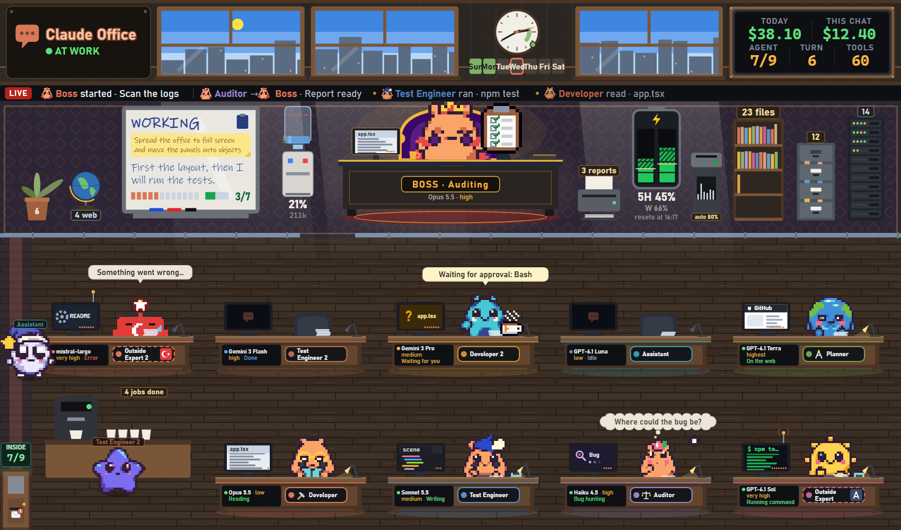
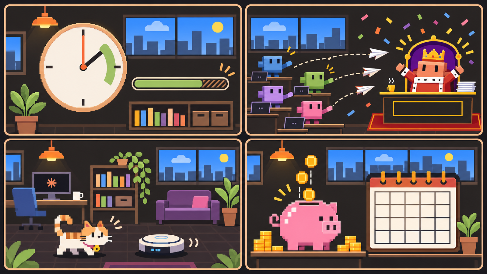
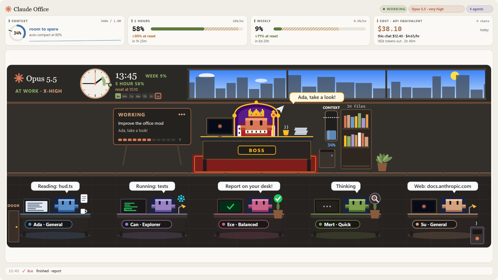
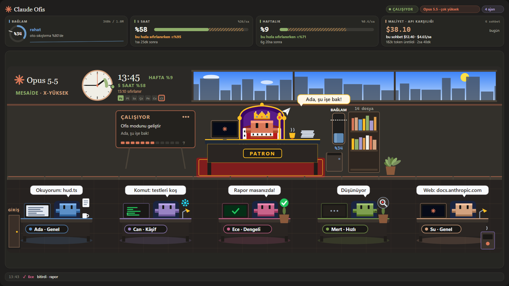
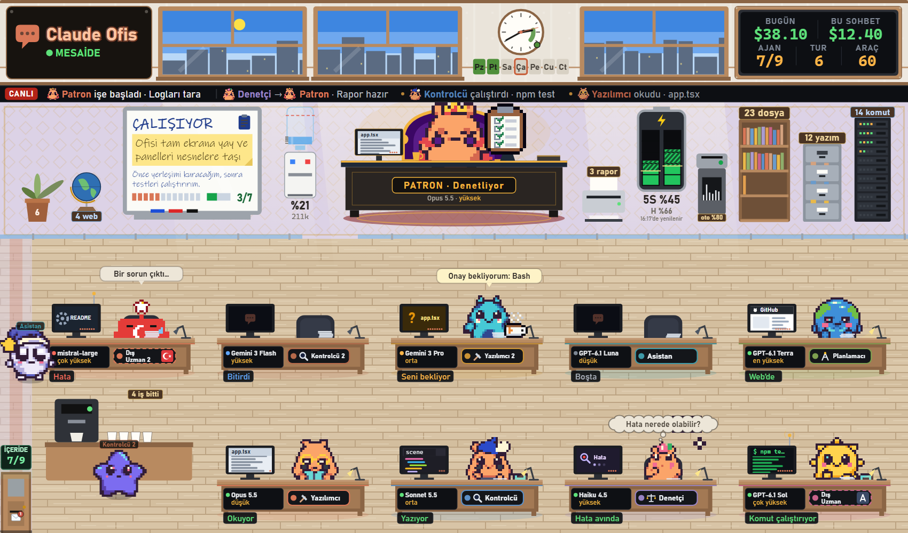
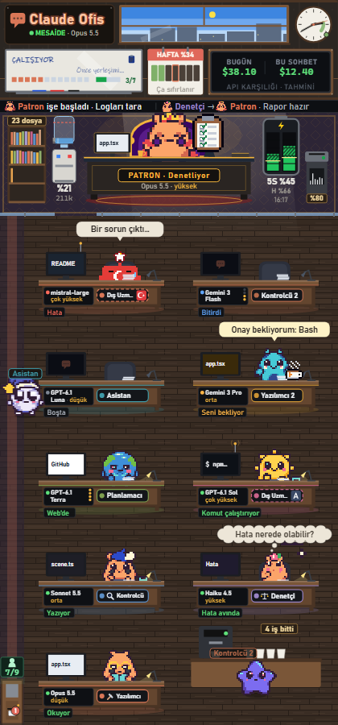

<div align="center">

# ✳️ Claude Office · Claude Ofis

**Watch Claude work as a live pixel office in a side pane.**<br>
**Claude'un çalışmasını yan panelde canlı bir piksel ofis olarak izle.**

[](#-english)
[](#-türkçe)
[](https://github.com/yigityildiz0/claude-pixel-office/archive/refs/heads/main.zip)


</div>

---

## 🇬🇧 English

See what Claude is doing at a glance, and see **when your limits will run out** before they do. **The boss** is Clawd with a crown. Every subagent walks in as a new worker, sits at a desk and says in a bubble what it is doing: reading, writing, running a command or browsing. As the team grows, the office adds desks. Everything fits the pane: no scrolling, nothing off screen.



### ✨ New in 0.4

| | What you get |
|---|---|
| 🔮 **Limit forecast** | The 5-hour and weekly cards show your **burn rate** (%/h) and, from your recent pace, **where you will be at the reset**. If you are on track to hit 100% first, they say **at what time it fills**, draw the projection as a hatched bar and put a red mark on the limit clock. |
| 💰 **Today's cost** | The cost card shows **today's total across every chat**, not just since the office opened, plus this chat's cost and its $/h. API-equivalent figures. |
| 🎭 **A livelier office** | An office cat and a robot vacuum wander about, birds fly past by day and meteors by night. Idle workers drink coffee, juggle, read the paper, stretch or take a call, never the same act twice in a row. When a worker finishes, the boss cheers with confetti, or sweats if it failed. |
| 🖥️ **Fits any pane** | Four cards on a wide pane, 2×2 on a narrow one; the office picks the best desk layout for the space. Spare room becomes a **recent events** list. |
| ⚙️ **Tidy controls** | One row of tabs plus **Settings ▾**: auto-compact, compact now, motion and hints fold out only when you need them. |



### 🖼️ Everything in the room means something

| In the room | What it tells you |
|---|---|
| 🕰️ **Limit clock** | An arc **from now to the 5-hour reset**; a red triangle where it **fills** if you are going too fast. Below: "HH:MM fills · HH:MM resets". |
| 📅 **Wall calendar** | The weekly limit as 7 days; the reset day is ringed, the day it would fill is red. |
| 🧪 **Context tank** | How full the context is; the dashed line is the **auto-compact threshold**. |
| 📋 **Task board** | Your request, the boss's current thought and this turn's steps. |
| 📚 **Bookshelf** | One book for every file read this session. |
| 🪧 **Sign** | Model, effort and **AT WORK / ON BREAK**. |
| 🔔 **Bell** | Rings when Claude is waiting for you. |

<table><tr>
<td width="68%"></td>
<td></td>
</tr><tr>
<td align="center">Light theme: follows the app</td>
<td align="center">Narrow pane: 2×2 cards, fewer desk columns</td>
</tr></table>

### ⬇️ Install

**In a Claude Code terminal:**

```
/plugin install pixel-office --marketplace yigityildiz0/claude-pixel-office
```

Answer `y`, press Enter, then type `/office` (by default the pane opens by itself).

**From a shell:**

```bash
claude plugin install pixel-office --marketplace yigityildiz0/claude-pixel-office
```

**In the desktop app:** **+** next to the prompt → **Plugins** → **Add marketplace** → `yigityildiz0/claude-pixel-office` → **Add plugin** → `pixel-office`.

**Already installed?** Open `/plugin`, refresh the `claude-pixel-office` marketplace, update `pixel-office`, then start a new session.

> 🤖 **To let Claude do it**, paste:
>
> ```
> Install the Claude Code mod "pixel-office" from the marketplace
> yigityildiz0/claude-pixel-office (the English one, not piksel-ofis),
> then open it with /office and check that it works.
> ```

### 🔒 Privacy and cost

The mod calls no model and adds nothing to the system prompt, so it **spends no tokens**. It sends nothing anywhere. Limit history and today's cost are kept in the mod's local store on your machine. With [claude-usage-band](https://github.com/yigityildiz0/claude-usage-band) installed too, the auto-compact setting is shared and the chat compacts only once.

> ⚠️ Install one language only: `pixel-office` **or** `piksel-ofis`.

### 🆓 Free to use, change and share

Claude Office is [MIT licensed](LICENSE): use it, change the room, ship your own version. Just keep the license
file. Ideas and fixes are welcome, see [CONTRIBUTING.md](CONTRIBUTING.md). If it made you smile, a ⭐ helps others
find it. Want Claude to share the work with your other AI subscriptions? Try the sister project
[Orkestra](https://github.com/yigityildiz0/orkestra).

<sub>Claude, Claude Code and Clawd are trademarks of Anthropic. This is an independent community mod, not made or
endorsed by Anthropic.</sub>

---

## 🇹🇷 Türkçe

Claude'un ne yaptığını tek bakışta gör; **limitlerin ne zaman biteceğini de bitmeden gör**. **Patron**, taçlı Clawd'dur. Her alt ajan ofise yeni bir çalışan olarak girer, masasına oturur ve ne yaptığını baloncukla söyler: okuyor, yazıyor, komut çalıştırıyor ya da web'de geziyor. Ekip büyüdükçe ofise masa eklenir. Her şey panele sığar: kaydırma yok, ekran dışında kalan bir şey yok.



### ✨ 0.4'te yeni

| | Ne kazanırsın |
|---|---|
| 🔮 **Limit tahmini** | 5 saatlik ve haftalık kartlar **harcama hızını** (%/sa) ve son temponla **sıfırlanırken nerede olacağını** gösterir. Sıfırlanmadan dolacaksan **saat kaçta dolacağını** yazar, tahmini taralı çubukla çizer ve limit saatine kırmızı işaret koyar. |
| 💰 **Bugünkü maliyet** | Maliyet kartı ofisi açtığından beri değil, **bugün bütün sohbetlerin toplamını** gösterir; ayrıca bu sohbetin maliyeti ve saatlik hızı. API karşılığı tutarlardır. |
| 🎭 **Daha canlı ofis** | Ofis kedisi ve robot süpürge dolaşır; gündüz kuşlar, gece meteorlar geçer. Boştaki çalışanlar kahve içer, top çevirir, gazete okur, gerinir ya da telefonla konuşur; aynı hareket arka arkaya gelmez. Bir çalışan işini bitirince patron konfetiyle kutlar, hata olursa terler. |
| 🖥️ **Her panele sığar** | Geniş panelde dört kart yan yana, dar panelde 2×2; ofis masa düzenini alana göre seçer. Artan alan **son olaylar** listesine döner. |
| ⚙️ **Derli toplu kontroller** | Tek satır sekme ve **Ayarlar ▾**: oto-sıkıştırma, şimdi sıkıştır, hareket ve ipuçları yalnız gerekince açılır. |


### 🖼️ Odada her şeyin bir anlamı var

| Odada gördüğün | Ne anlatıyor |
|---|---|
| 🕰️ **Limit saati** | **Şimdiden 5 saatlik sıfırlanmaya** uzanan yay; çok hızlı gidiyorsan **dolacağı** yerde kırmızı üçgen. Altında "SS:DD dolar · SS:DD sıfır". |
| 📅 **Duvar takvimi** | Haftalık limit 7 gün olarak; sıfırlanma günü halkalı, dolacağı gün kırmızı. |
| 🧪 **Bağlam tankı** | Bağlamın doluluğu; kesik çizgi **oto-sıkıştırma eşiği**. |
| 📋 **Görev panosu** | İsteğin, patronun o anki düşüncesi ve turdaki adımlar. |
| 📚 **Kitaplık** | Oturumda okunan her dosya için bir kitap. |
| 🪧 **Tabela** | Model, efor ve **MESAİDE / MOLA**. |
| 🔔 **Zil** | Claude senden yanıt beklerken çalar. |

<table><tr>
<td width="68%"></td>
<td></td>
</tr><tr>
<td align="center">Açık tema: uygulamaya uyar</td>
<td align="center">Dar panel: 2×2 kart, daha az masa sütunu</td>
</tr></table>

### ⬇️ Kurulum

**Claude Code terminalinde:**

```
/plugin install piksel-ofis --marketplace yigityildiz0/claude-pixel-office
```

`y` yaz, Enter'a bas, sonra `/ofis` yaz (varsayılan ayarda panel kendiliğinden açılır).

**Kabuktan:**

```bash
claude plugin install piksel-ofis --marketplace yigityildiz0/claude-pixel-office
```

**Masaüstü uygulamasında:** istem kutusunun yanındaki **+** → **Plugins** → **Add marketplace** → `yigityildiz0/claude-pixel-office` → **Add plugin** → `piksel-ofis`.

**Zaten kurulu mu?** `/plugin` menüsünde `claude-pixel-office` marketini yenile, `piksel-ofis`i güncelle, sonra yeni oturum aç.

> 🤖 **Claude'a yaptırmak istersen** şunu yapıştır:
>
> ```
> Claude Code için "piksel-ofis" modunu kur: marketplace yigityildiz0/claude-pixel-office.
> Türkçe sürümü (piksel-ofis) kur, İngilizce pixel-office'i kurma. Kurduktan sonra
> /ofis ile paneli aç ve çalıştığını kontrol et.
> ```

### 🔒 Gizlilik ve maliyet

Mod model çağırmaz ve sistem istemine bir şey eklemez, bu yüzden **token harcamaz**. Hiçbir yere veri göndermez. Limit geçmişi ve günlük maliyet, modun bilgisayarındaki yerel deposunda tutulur. [claude-usage-band](https://github.com/yigityildiz0/claude-usage-band) de kuruluysa oto-sıkıştırma ayarı ortak kullanılır ve sohbet yalnız bir kez sıkıştırılır.

> ⚠️ Tek dil kur: `piksel-ofis` **ya da** `pixel-office`.

### 🆓 Özgürce kullan, değiştir, paylaş

Claude Ofis [MIT lisanslıdır](LICENSE): kullan, odayı değiştir, kendi sürümünü yayımla. Yalnız lisans dosyasını
koru. Fikir ve düzeltmelere açık: [CONTRIBUTING.md](CONTRIBUTING.md). Yüzünü güldürdüyse bir ⭐ başkalarının da
bulmasını sağlar. Claude'un işi diğer yapay zekâ aboneliklerinle paylaşmasını istersen kardeş proje:
[Orkestra](https://github.com/yigityildiz0/orkestra).

<sub>Claude, Claude Code ve Clawd, Anthropic'in markalarıdır. Bu bağımsız bir topluluk modudur; Anthropic yapmamış
ya da onaylamamıştır.</sub>

<div align="center"><sub>MIT · <a href="LICENSE">LICENSE</a> · Illustrations made with GPT image generation · Çizimler GPT görsel üretimiyle yapıldı</sub></div>
