<div align="center">

# Claude Office · Claude Ofis

Watch your AI team work as a pixel office.<br>
Yapay zekâ ekibinin çalışmasını canlı bir piksel ofiste izle.

[](#english)
[](#turkce)
[](https://github.com/yigityildiz0/claude-pixel-office/archive/refs/heads/main.zip)


[](LICENSE)


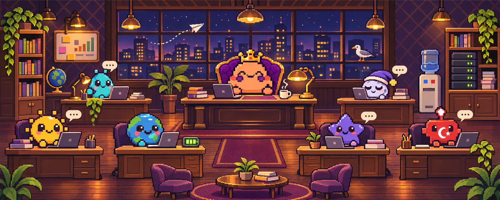

</div>

<a id="english"></a>

## English

Claude Office turns Claude Code's side pane into a live pixel office. Claude sits at the boss's desk; subagents arrive through the door and take their own desks. Their screens, plates and speech bubbles show what they are doing. This repository contains the same mod in two languages: **pixel-office** in English and **piksel-ofis** in Turkish, both at **0.9.0**.


### ✨ What's new across 0.8 and 0.9

The office now fills the pane, with work and usage information built into the room. Version 0.9 adds task-specific activity animations.

| Feature | What you see |
|---|---|
| **Animations for the work** | **48 main activities**, plus 2 variants and 2 extra layers in the animation catalog. Painting, coding, bug hunting, team supervision, binocular watching, web research, test tubes, compiling and drawing plans each get their own scene. Activities follow tool calls, task text and worker state. |
| **Model and effort plates** | Each desk has a model name and an effort level when known. Desk cards name the role; monitors show the current work. Detail adapts to the room available. |
| **Titles that follow the job** | Developer, Test Engineer, Auditor, Explorer, Planner and Assistant are among the titles. A worker leading other agents becomes Deputy Boss. Repeated titles receive a number. |
| **The whole pane is the office** | Limits live in a battery, context in a water cooler and reading activity in a bookshelf. The layout adapts to narrow and wide panes. In the desktop app, the light and dark themes follow the app. |
| **Desks that move with the team** | New workers walk in. Finished workers leave through the door, and the remaining team walks to its repacked desks. |
| **Original characters** | **12 characters**, with 9 shared base states: idle, walk, wave, work, think, read, wait, done and fail. Running is an additional state; characters without a running strip use a faster walk. |
| **Messages become little scenes** | Paper planes travel between desks. Messages from outside the room can arrive with a gull, a pigeon, an envelope under the door or a pneumatic tube. |
| **Energy and forecasts** | The battery shows remaining five-hour and weekly allowance. When usage and reset data are available, recent pace estimates when the limit will fill or what usage will be at reset. These are estimates, not guarantees. |
| **Context you can see** | Water level shows context fullness. A dashed line marks the enabled auto-compact threshold. Settings offer automatic and manual compaction. |
| **A tired office** | As used allowance rises, workers slow down, yawn and sweat. At an exhausted five-hour limit, the boss can nap. |
| **Outside CLI workers** | Recognized Codex, Gemini CLI, Antigravity (`agy`) and EVREN helper jobs take desks as Outside Experts. Their model and effort are read when available. An Antigravity job keeps its model's character and gets a neutral A badge. |
| **EVREN support** | The EVREN helper and Codex's `evren` profile are recognized. These workers use the red crescent-and-star robot regardless of model. A recognized multi-model EVREN helper call creates a desk for each model. |

<details>
<summary>See arrivals, departures and desk repacking</summary>

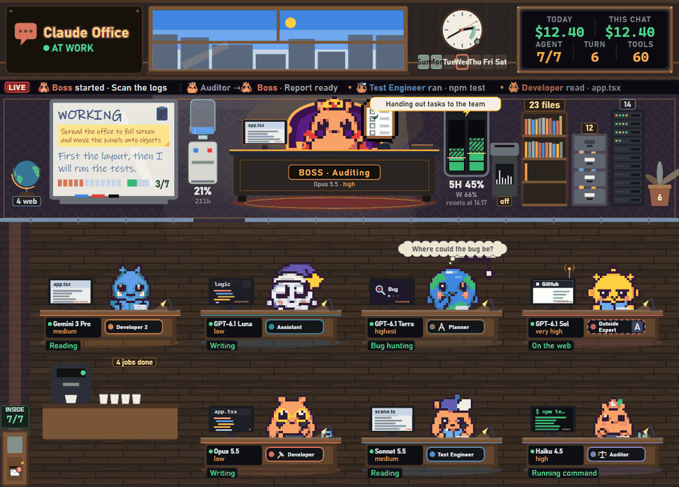

</details>

<table>
<tr><td width="50%">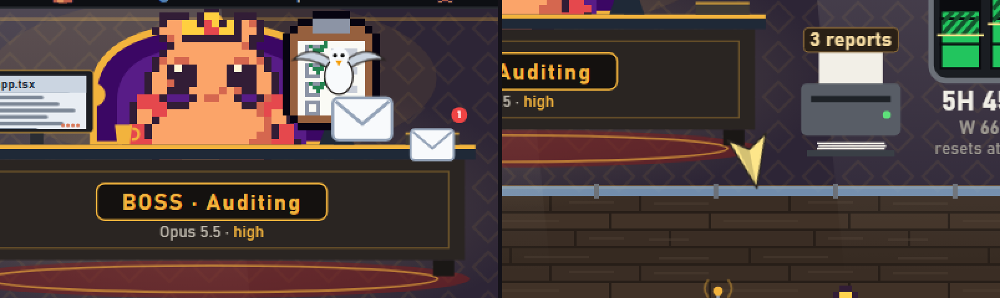</td><td width="50%">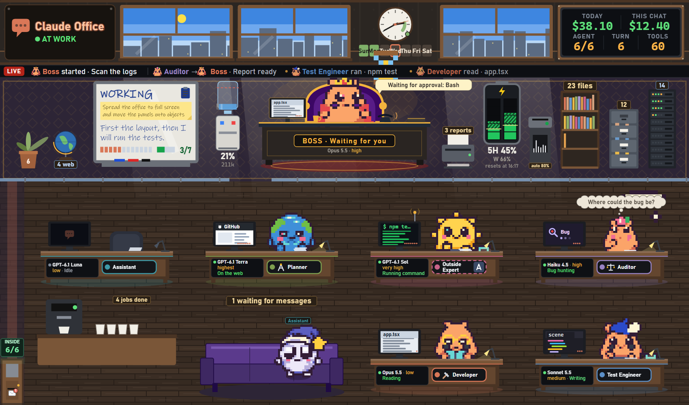</td></tr>
<tr><td>Mail and messages</td><td>Waiting for your approval</td></tr>
</table>

<details>
<summary>See the office running low on energy</summary>

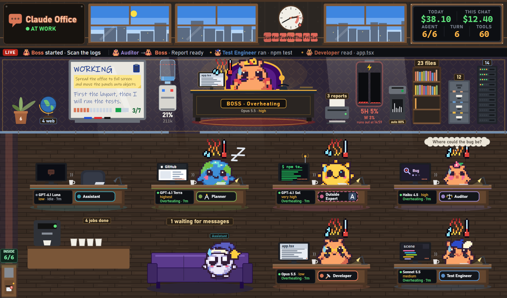

</details>

### Everything in the room means something

| Object | What it tells you |
|---|---|
| **Boss's throne and desk** | Claude's current state, model and effort, with an inbox and report stack. A bell signals waiting for you. |
| **Worker's desk** | Role, model, effort and current activity, with detail adjusted to available space. |
| **Battery** | Remaining five-hour and weekly allowance, reset time and a forecast when enough data is available. |
| **Water cooler** | Context percentage, token figures when available and the enabled auto-compact threshold. |
| **Shredder** | Auto-compact setting and threshold; it shreds paper during compaction. |
| **Whiteboard** | Your request, the current thought or activity, turn steps and plan progress when available. |
| **Bookshelf** | Reading count, driven by Read tool calls. |
| **Archive cabinet** | Writing activity from editing and writing tools. |
| **Server rack** | Command activity; lights blink while a command runs. |
| **Globe and plant** | Web activity on the globe; the plant grows with conversation turns. |
| **Printer** | Report count, with a printing scene when a report arrives. |
| **Coffee corner and sofa** | Completed jobs at the coffee counter; teammates resting while waiting for messages on the sofa. |
| **Meeting table and door** | Messages on the table; inside/total agents and incoming mail at the door. |
| **Clock and calendar** | Time, limit reset markers and projected exhaustion markers when available. |
| **Scoreboard and news ticker** | Today's recorded cost, this chat's cost and activity counters; recent events travel across the ticker. Cost figures are estimated API equivalents. |

### Screenshots

<details>
<summary>Open the gallery: empty room, teams, narrow and wide panes, light theme</summary>

<table>
<tr><td width="50%">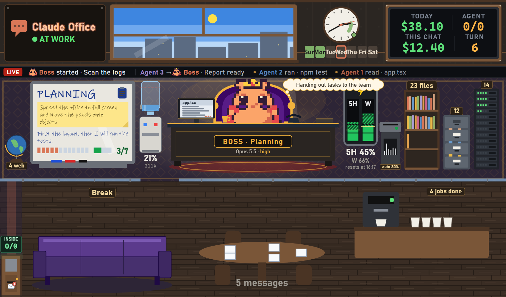</td><td width="50%"></td></tr>
<tr><td>No subagents</td><td>Three agents</td></tr>
<tr><td colspan="2"></td></tr>
<tr><td colspan="2">Twenty agents</td></tr>
<tr><td></td><td>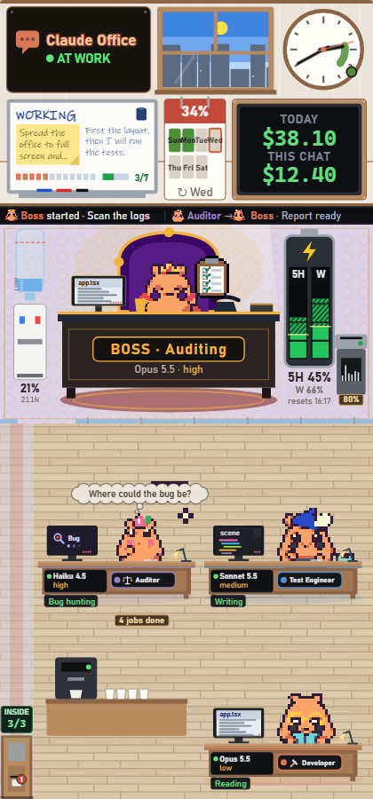</td></tr>
<tr><td>Narrow, dark</td><td>Narrow, light</td></tr>
<tr><td colspan="2"></td></tr>
<tr><td colspan="2">Wide pane</td></tr>
<tr><td colspan="2"></td></tr>
<tr><td colspan="2">Light theme</td></tr>
</table>

</details>

### Install

**In a Claude Code terminal:**

```text
/plugin install pixel-office --marketplace yigityildiz0/claude-pixel-office
```

Accept the installation prompt, then type `/office`. The pane opens automatically by default on desktop and VS Code surfaces. A terminal surface shows a text view of the office.

**From a shell:**

```bash
claude plugin install pixel-office --marketplace yigityildiz0/claude-pixel-office
```

**In the desktop app:** **+** next to the prompt → **Plugins** → **Add marketplace** → `yigityildiz0/claude-pixel-office` → **Add plugin** → `pixel-office`.

**Update:** Open `/plugin`, refresh the `claude-pixel-office` marketplace, update `pixel-office`, then start a new session.

> **Let Claude do it.** Paste this into Claude Code:
>
> Install the English Claude Code mod "pixel-office" from the marketplace
> yigityildiz0/claude-pixel-office. Open it with /office and check that it works.

> **Install one language only:** `pixel-office` or `piksel-ofis`.

### Privacy and cost

The office renderer makes no model calls and adds nothing to the system prompt, so displaying the office spends **0 tokens**. The mod's hooks contain no outbound network calls. They read Claude Code's session events and usage data; limit history and daily cost records use its local plugin store.

Optional compaction asks Claude Code to compact the conversation. The zero-token statement describes the office display, not the work Claude or outside tools perform, or compaction.

With [claude-usage-band](https://github.com/yigityildiz0/claude-usage-band) installed too, auto-compact settings are shared locally and coordinated so the two mods do not compact the same chat twice.

### Free to use, change and share

Claude Office is [MIT licensed](LICENSE). Use it, change the room or share your version while keeping the license notice. Ideas and fixes are welcome: [CONTRIBUTING.md](CONTRIBUTING.md).

Want Claude to share work with your other AI subscriptions? See the sister project [Orkestra](https://github.com/yigityildiz0/orkestra).

<sub>Claude and Claude Code are trademarks of Anthropic; GPT of OpenAI; Gemini and Antigravity of Google. This is an independent community mod, not made, supported or endorsed by those companies. Model names indicate compatibility only. The office characters are original creations, not those companies' mascots.</sub>

---

<a id="turkce"></a>

## Türkçe

Claude Ofis, Claude Code'un yan panelini canlı bir piksel ofise dönüştürür. Claude patron masasında oturur; alt ajanlar kapıdan girip kendi masalarına geçer. Ekranlar, plakalar ve konuşma balonları ne yaptıklarını gösterir. Depoda aynı modun iki dili var: İngilizce **pixel-office** ve Türkçe **piksel-ofis**. İkisi de **0.9.0** sürümünde.


### ✨ 0.8 ve 0.9 ile gelenler

Ofis artık paneli dolduruyor. İş ve kullanım bilgileri odadaki eşyalarda yaşıyor. 0.9 sürümü, yapılan işe göre değişen etkinlik animasyonlarını ekliyor.

| Özellik | Ofiste gördüğün |
|---|---|
| **Her işe ayrı animasyon** | Katalogda **48 ana etkinlik**, 2 varyant ve 2 ek katman var. Resim çizme, kod yazma, hata avı, ekibi gözetleme, dürbünle izleme, web araştırması, deney tüpüyle test, derleme ve plan çizme kendi sahnelerine sahip. Etkinlikler araç çağrılarına, görev metnine ve çalışanın durumuna göre seçiliyor. |
| **Model ve efor plakaları** | Biliniyorsa model adı ve efor seviyesi masada görünüyor. Masa kartı unvanı, monitör yapılan işi anlatıyor. Ayrıntı miktarı alana göre değişiyor. |
| **İşe göre unvan** | Yazılımcı, Test Mühendisi, Denetçi, Kâşif, Planlamacı ve Asistan bunlardan bazıları. Alt ajan yöneten çalışan Yedek Patron oluyor. Aynı unvan tekrarlanırsa numara alıyor. |
| **Paneli dolduran ofis** | Limit bataryada, bağlam su sebilinde, okuma sayısı kitaplıkta. Oda dar ve geniş panele göre yerleşiyor. Masaüstü uygulamasında açık ve koyu tema uygulamaya uyuyor. |
| **Ekiple birlikte değişen masalar** | Yeni çalışan kapıdan giriyor. İşi biten kapıdan çıkıyor; kalan ekip yeniden düzenlenen masalarına yürüyor. |
| **Özgün karakterler** | **12 karakter** ve ortak 9 temel durum: boşta, yürüme, el sallama, çalışma, düşünme, okuma, bekleme, bitirme ve hata. Kodda bunlar idle, walk, wave, work, think, read, wait, done ve fail. Koşma ek bir durum; koşma şeridi olmayan karakter daha hızlı yürüyor. |
| **Mesajların küçük sahneleri** | Masalar arasında kâğıt uçaklar uçuyor. Odanın dışından gelen mesajlar martıyla, güvercinle, kapı altından kayan zarfla ya da boru postasıyla gelebiliyor. |
| **Enerji ve bitiş tahmini** | Batarya, beş saatlik ve haftalık kalan hakkı gösteriyor. Kullanım ve sıfırlama bilgisi varsa son tempoya göre limitin dolacağı zamanı veya sıfırlanırken ulaşılacak kullanımı tahmin ediyor. Bu bir tahmin, kesinlik değil. |
| **Gözünün önündeki bağlam** | Su seviyesi bağlamın doluluğu. Kesik çizgi, etkinleştirilmiş oto-sıkıştırma eşiği. Ayarlardan otomatik veya elle sıkıştırma yapılabiliyor. |
| **Yorulan ofis** | Kullanılan hak arttıkça çalışanlar yavaşlıyor, esniyor ve terliyor. Beş saatlik hak tükenince patron uyuklayabiliyor. |
| **Dış araç çalışanları** | Tanınan Codex, Gemini CLI, Antigravity (`agy`) ve EVREN yardımcı aracı işleri Dış Uzman olarak masaya oturuyor. Biliniyorsa model ve efor okunuyor. Antigravity işi kendi modelinin karakterini koruyor; yanında sade bir A rozeti taşıyor. |
| **EVREN desteği** | EVREN yardımcı aracı ve Codex'in `evren` profili tanınıyor. Model ne olursa olsun kırmızı, ay-yıldızlı robot kullanılıyor. Tanınan çok modelli EVREN çağrısında her model ayrı masaya oturuyor. |

<details>
<summary>Giriş, çıkış ve masaların yeniden düzenlenmesini izle</summary>

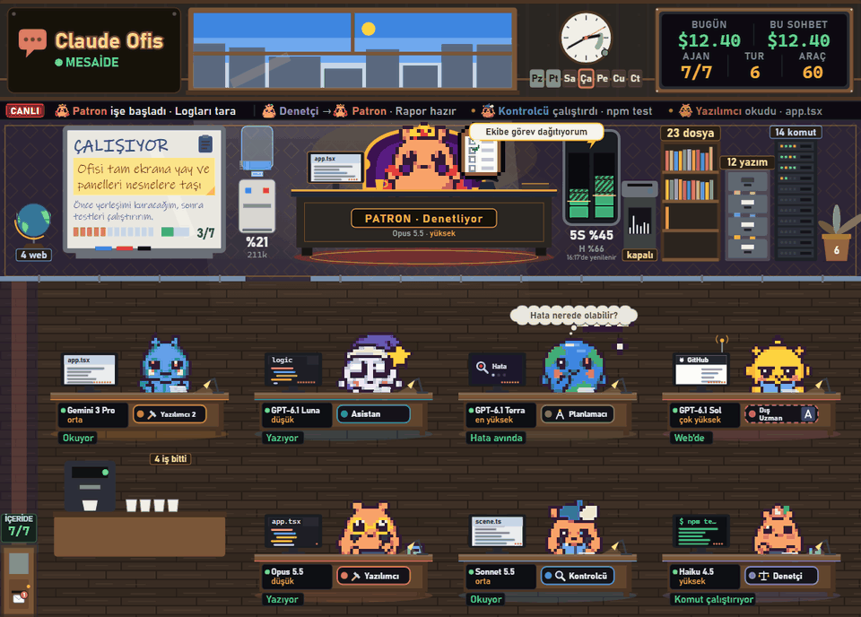

</details>

<table>
<tr><td width="50%"></td><td width="50%">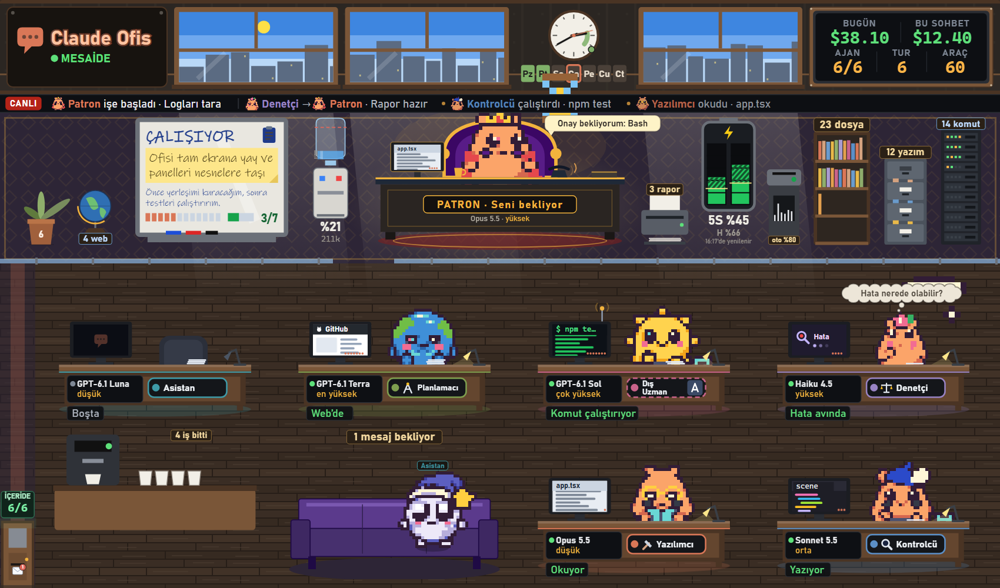</td></tr>
<tr><td>Posta ve mesajlar</td><td>Onayını beklerken</td></tr>
</table>

<details>
<summary>Enerjisi azalan ofisi gör</summary>

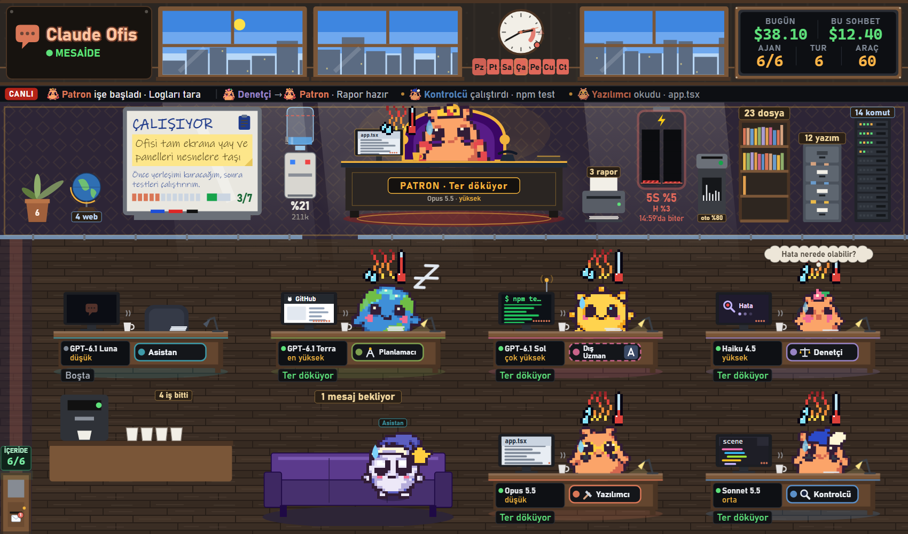

</details>

### Odada her şeyin bir anlamı var

| Nesne | Ne anlatıyor |
|---|---|
| **Patronun tahtı ve masası** | Claude'un durumu, modeli ve eforu; gelen kutusu ve rapor yığını. Seni beklerken zil çalıyor. |
| **Çalışanın masası** | Unvan, model, efor ve güncel etkinlik. Ayrıntılar alana göre değişiyor. |
| **Batarya** | Beş saatlik ve haftalık kalan hak, sıfırlama zamanı ve veri yeterliyse bitiş tahmini. |
| **Su sebili** | Bağlam yüzdesi, varsa token bilgisi ve etkinleştirilmiş oto-sıkıştırma eşiği. |
| **Kâğıt öğütücü** | Oto-sıkıştırma ayarı ve eşiği; sıkıştırma sırasında kâğıt öğütüyor. |
| **Beyaz tahta** | İsteğin, güncel düşünce veya etkinlik, tur adımları ve varsa planın ilerleyişi. |
| **Kitaplık** | Read aracı çağrılarıyla artan okuma sayısı. |
| **Arşiv dolabı** | Düzenleme ve yazma araçlarından gelen yazım etkinliği. |
| **Sunucu rafı** | Komut etkinliği; komut çalışırken ışıkları yanıp sönüyor. |
| **Küre ve bitki** | Küre web etkinliğini gösteriyor; bitki sohbet turlarıyla büyüyor. |
| **Yazıcı** | Rapor sayısı; rapor gelince yazdırma sahnesi oynuyor. |
| **Kahve köşesi ve kanepe** | Kahve tezgâhında biten işler; kanepede mesaj beklerken dinlenen ekip arkadaşları. |
| **Toplantı masası ve kapı** | Masada mesajlar; kapıda içerideki/toplam ajan ve gelen posta. |
| **Saat ve takvim** | Zaman, limitin sıfırlanma işaretleri ve veri varsa tahmini bitiş işaretleri. |
| **Maliyet tabelası ve haber şeridi** | Bugünün kaydedilmiş maliyeti, bu sohbetin maliyeti ve etkinlik sayaçları; şeritte son olaylar. Tutarlar tahmini API karşılığıdır. |

### Ekran görüntüleri

<details>
<summary>Galeriyi aç: boş oda, ekipler, dar ve geniş panel, açık tema</summary>

<table>
<tr><td width="50%"></td><td width="50%">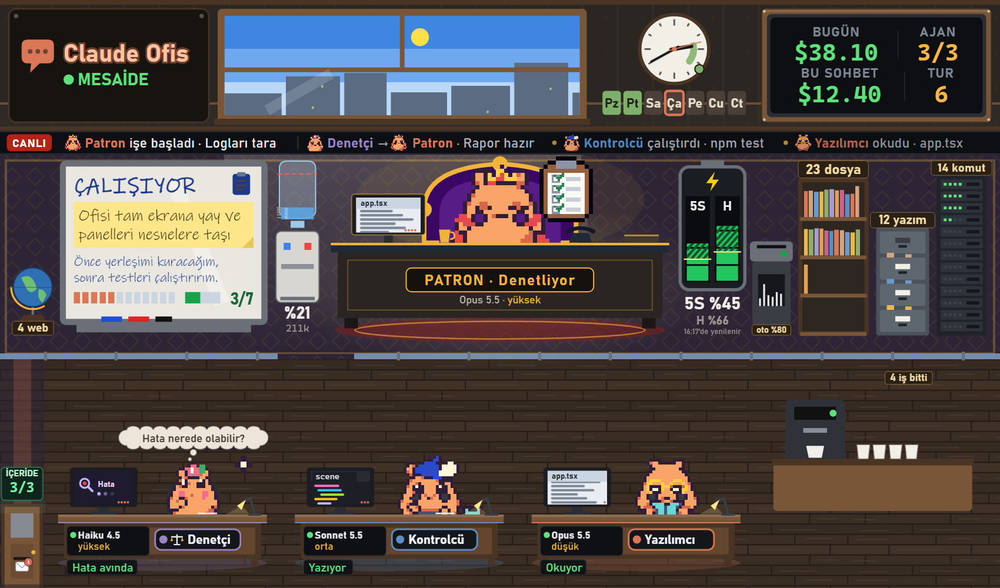</td></tr>
<tr><td>Alt ajan yokken</td><td>Üç ajan</td></tr>
<tr><td colspan="2">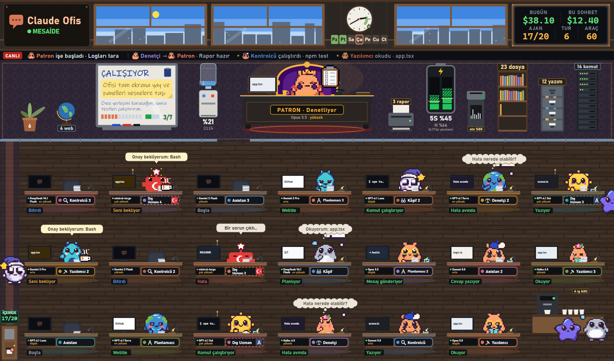</td></tr>
<tr><td colspan="2">Yirmi ajan</td></tr>
<tr><td></td><td></td></tr>
<tr><td>Dar panel, koyu tema</td><td>Dar panel, açık tema</td></tr>
<tr><td colspan="2">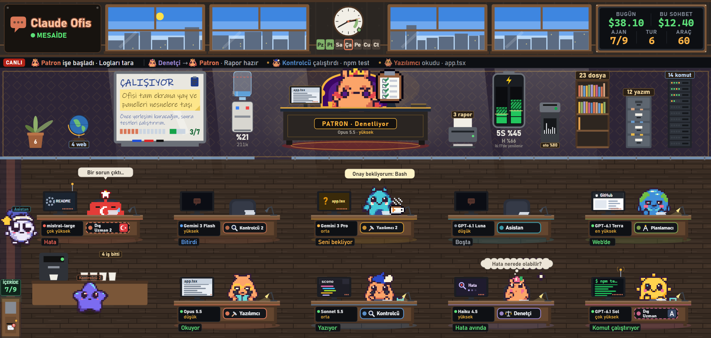</td></tr>
<tr><td colspan="2">Geniş panel</td></tr>
<tr><td colspan="2"></td></tr>
<tr><td colspan="2">Açık tema</td></tr>
</table>

</details>

### Kurulum

**Claude Code terminalinde:**

```text
/plugin install piksel-ofis --marketplace yigityildiz0/claude-pixel-office
```

Kurulum isteğini onayla, ardından `/ofis` yaz. Varsayılan ayarda panel masaüstü ve VS Code yüzeylerinde kendiliğinden açılır. Terminal yüzeyinde ofisin metin görünümü gösterilir.

**Kabuktan:**

```bash
claude plugin install piksel-ofis --marketplace yigityildiz0/claude-pixel-office
```

**Masaüstü uygulamasında:** istem kutusunun yanındaki **+** → **Plugins** → **Add marketplace** → `yigityildiz0/claude-pixel-office` → **Add plugin** → `piksel-ofis`.

**Güncelleme:** `/plugin` menüsünden `claude-pixel-office` marketini yenile, `piksel-ofis`i güncelle ve yeni oturum aç.

> **Claude'a yaptır.** Bunu Claude Code'a yapıştır:
>
> Claude Code için "piksel-ofis" modunun Türkçe sürümünü kur.
> Market: yigityildiz0/claude-pixel-office. /ofis ile aç ve çalıştığını kontrol et.

> **Tek dil kur:** `piksel-ofis` ya da `pixel-office`.

### Gizlilik ve maliyet

Ofisin çizimi model çağırmaz ve sistem istemine bir şey eklemez. Bu yüzden ofisi göstermek **0 token** harcar. Modun kancalarında dışarıya ağ çağrısı yoktur. Claude Code'un oturum olayları ve kullanım verileri okunur; limit geçmişi ve günlük maliyet kayıtları yerel eklenti deposunda tutulur.

İsteğe bağlı sıkıştırma, konuşmayı sıkıştırmasını Claude Code'dan ister. Sıfır token ifadesi ofisin gösterimini anlatır; Claude'un veya dış araçların yaptığı işi ve sıkıştırmayı kapsamaz.

[claude-usage-band](https://github.com/yigityildiz0/claude-usage-band) de kuruluysa oto-sıkıştırma ayarı yerel olarak paylaşılır. İki modun aynı sohbeti iki kez sıkıştırmaması için işlem koordine edilir.

### Özgürce kullan, değiştir, paylaş

Claude Ofis [MIT lisanslıdır](LICENSE). Lisans bildirimini koruyarak kullanabilir, odayı değiştirebilir ve kendi sürümünü paylaşabilirsin. Fikir ve düzeltmeler için: [CONTRIBUTING.md](CONTRIBUTING.md).

Claude'un işleri diğer yapay zekâ aboneliklerinle paylaşmasını istersen kardeş proje [Orkestra](https://github.com/yigityildiz0/orkestra)'ya bak.

<sub>Claude ve Claude Code Anthropic'in; GPT OpenAI'nin; Gemini ve Antigravity Google'ın ticari markalarıdır. Bu bağımsız bir topluluk modudur. Adı geçen şirketler tarafından yapılmamış, desteklenmemiş veya onaylanmamıştır. Model adları yalnızca uyumluluğu belirtir. Ofisteki karakterler özgündür; bu şirketlerin maskotları değildir.</sub>

<div align="center"><sub>MIT · <a href="LICENSE">LICENSE</a> · Cover art made with GPT Image · Kapaklar GPT Image ile üretildi</sub></div>
