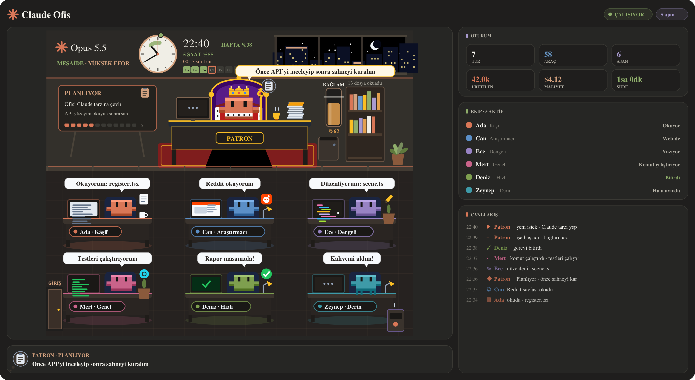
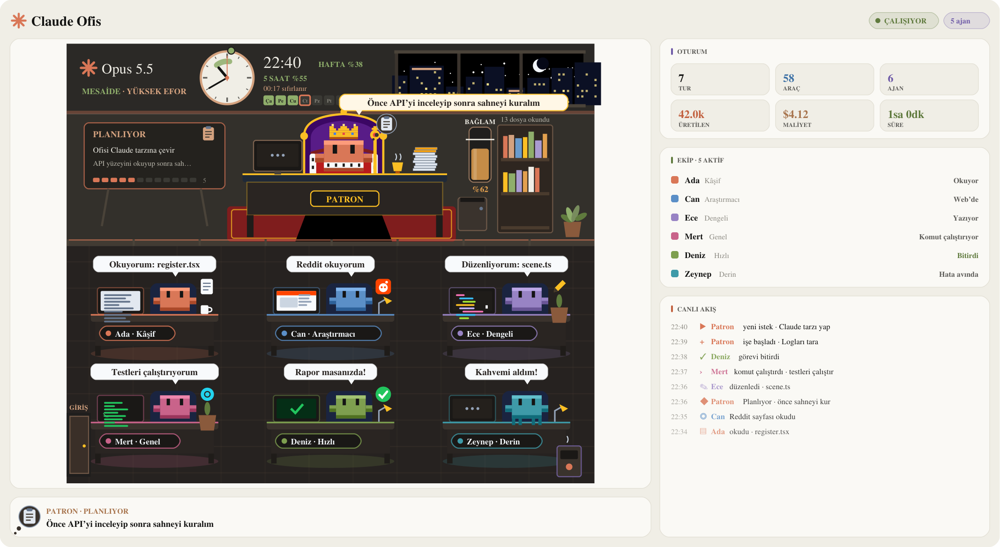
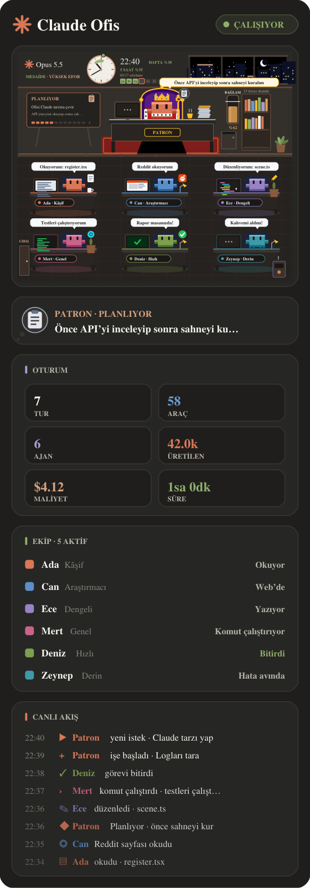
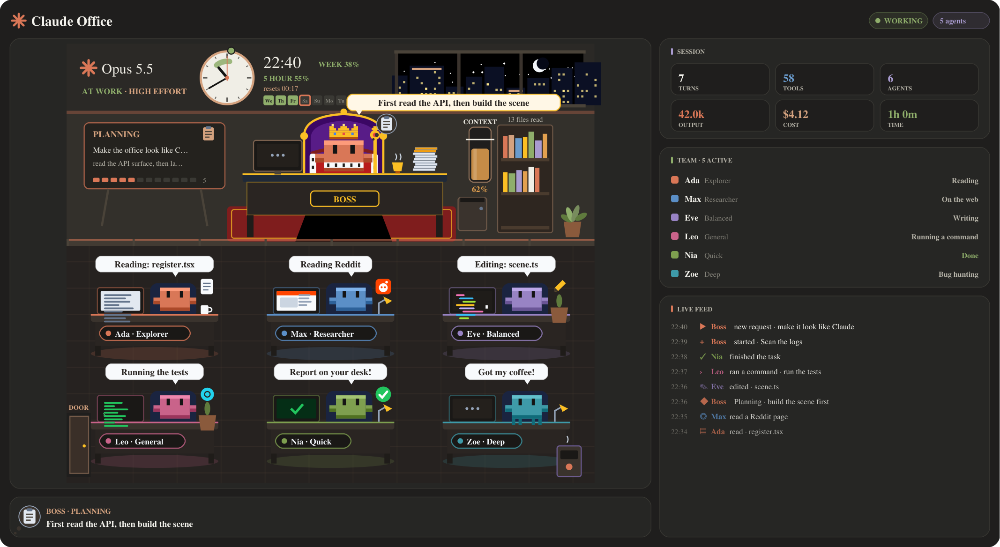
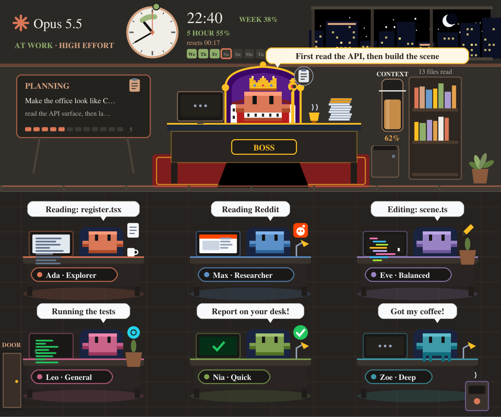
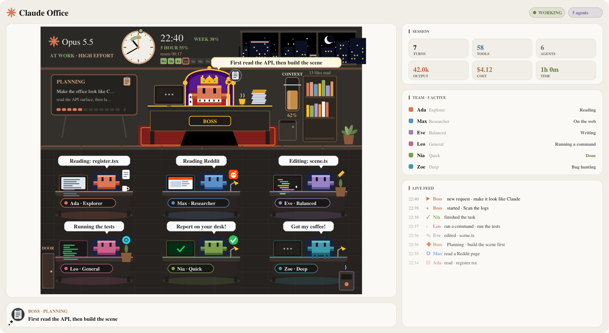
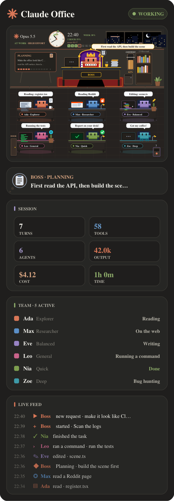

<div align="center">

# ✳️ Claude Office · Claude Ofis

**Claude'un çalışmasını yan panelde canlı bir piksel ofis olarak izle.**<br>
**Watch Claude work as a live pixel office in a side pane.**

[](#-türkçe)
[](#-english)
[](https://github.com/yigityildiz0/claude-pixel-office/archive/refs/heads/main.zip)




</div>

---

## 🇹🇷 Türkçe

Claude çalışırken ne yaptığını tek bakışta görürsün. **Patron**, taçlı Claude'dur. Her alt ajan ofise yeni bir çalışan olarak girer ve masasına oturur. Okuyor, yazıyor, komut çalıştırıyor ya da web'de geziyorsa bunu baloncukla söyler. Ekip büyüdükçe ofise yeni masa sıraları eklenir.

### 🖼️ Odada her şeyin bir anlamı var


| Odada gördüğün | Ne anlatıyor |
|---|---|
| 🕰️ **Limit saati** | Analog kadranda **şimdiden 5 saatlik limitin sıfırlanacağı ana kadar** renkli bir yay ve sıfırlanma noktasında bir işaret var. Yanında dijital saat, kullanım yüzdesi ve sıfırlanma saati yazar. |
| 📅 **Duvar takvimi** | Haftalık limit 7 gün olarak gösterilir. Kullanılan pay doludur, **sıfırlanma günü halkalıdır**. |
| 🧪 **Bağlam tankı** | Bağlamın ne kadar dolu olduğunu gösterir. Kesik çizgi **oto-sıkıştırma eşiğidir**. |
| 📋 **Görev panosu** | Senin isteğin, Patron'un o anki düşüncesi ve turdaki adımlar burada görünür. |
| 📚 **Kitaplık** | Oturumda okunan her dosya için bir kitap eklenir. |
| 🪴 **Saksı** | Her iki turda bir yaprak büyür. |
| 🪧 **Tabela** | Model, efor düzeyi ve **MESAİDE / MOLA** durumunu gösterir. |
| 💬 **Baloncuklar** | Her çalışanın o an ne yaptığını gösterir: dosya, komut ya da site. |

### 🎛️ Yönetim düğmeleri

Panelin üstünde şunlar var: **Genel · Ekip · Bağlam** sekmeleri, **Oto-sıkıştırma** aç/kapat, eşik **−5 / +5**, **Şimdi sıkıştır** ve **Hareket** aç/kapat.

<table><tr>
<td width="62%"></td>
<td></td>
</tr><tr>
<td align="center">Açık tema: uygulamanın temasına uyar</td>
<td align="center">Dar panel: her şey alt alta dizilir</td>
</tr></table>

### ⬇️ Kurulum

**Claude Code terminalinde** şunu yaz:

```
/plugin install piksel-ofis --marketplace yigityildiz0/claude-pixel-office
```

Soru gelince `y` yaz, sonra Enter'a bas. Ardından `/ofis` yazarsan panel açılır; varsayılan ayarda zaten kendiliğinden açılır.

**Kabuktan** kurmak için:

```bash
claude plugin install piksel-ofis --marketplace yigityildiz0/claude-pixel-office
```

**Masaüstü uygulamasında** şu adımları izle:
1. İstem kutusunun yanındaki **+** düğmesine bas.
2. **Plugins** → **Add marketplace** seç ve `yigityildiz0/claude-pixel-office` yaz.
3. **Add plugin** ile `piksel-ofis` modunu ekle.

> 🤖 **Claude'a yaptırmak istersen** şu mesajı aynen yapıştır:
>
> ```
> Claude Code için "piksel-ofis" modunu kur: marketplace yigityildiz0/claude-pixel-office.
> Türkçe sürümü (piksel-ofis) kur, İngilizce pixel-office'i kurma. Kurduktan sonra
> /ofis ile paneli aç ve çalıştığını kontrol et.
> ```

### 🤝 Kota bandıyla birlikte

[claude-usage-band](https://github.com/yigityildiz0/claude-usage-band) de kuruluysa oto-sıkıştırma ayarı ikisi arasında **ortak** kullanılır: hangisinden değiştirirsen değiştir, sohbet **tek bir kez** sıkıştırılır. Hangisi tek başına kuruluysa sıkıştırmayı o yapar.

> ⚠️ Aynı modun iki dilini birlikte kurma: ya `piksel-ofis` ya `pixel-office`.

Gizlilik: mod hiçbir yere veri göndermez. Token harcamaz, arka planda süreç başlatmaz.

---

## 🇬🇧 English

See what Claude is doing at a glance. **The boss** is Clawd with a crown. Every subagent walks in as a new worker and sits at a desk. A bubble says what each one is doing: reading, writing, running a command or browsing. As the team grows, the office adds new rows of desks.



### 🖼️ Everything in the room means something



| In the room | What it tells you |
|---|---|
| 🕰️ **Limit clock** | On the analog face, a coloured arc runs **from now to the moment the 5-hour limit resets**, with a dot at the reset. The digital time, the % used and the reset time sit beside it. |
| 📅 **Wall calendar** | The weekly limit as 7 days. The used share is filled in and **the reset day is ringed**. |
| 🧪 **Context tank** | How full the context is. The dashed line is **the auto-compact threshold**. |
| 📋 **Task board** | Your request, the boss's current thought and the steps of this turn. |
| 📚 **Bookshelf** | One book for every file read this session. |
| 🪴 **Plant** | Grows a leaf every two turns. |
| 🪧 **Sign** | The model, its effort and **AT WORK / ON BREAK**. |
| 💬 **Bubbles** | What each worker is on right now: a file, a command or a site. |

### 🎛️ Controls

Along the top of the pane: the **Overview · Team · Context** tabs, an **Auto-compact** on/off switch, the threshold **−5 / +5**, **Compact now** and **Motion** on/off.

<table><tr>
<td width="62%"></td>
<td></td>
</tr><tr>
<td align="center">Light theme: follows the app's theme</td>
<td align="center">Narrow pane: everything stacks</td>
</tr></table>

### ⬇️ Install

**In a Claude Code terminal**, type:

```
/plugin install pixel-office --marketplace yigityildiz0/claude-pixel-office
```

When asked, type `y`, then press Enter. Type `/office` to open the pane; by default it opens on its own.

**From a shell**:

```bash
claude plugin install pixel-office --marketplace yigityildiz0/claude-pixel-office
```

**In the desktop app**:
1. Click **+** next to the prompt box.
2. Choose **Plugins** → **Add marketplace** and enter `yigityildiz0/claude-pixel-office`.
3. Use **Add plugin** to add `pixel-office`.

> 🤖 **To let Claude do it**, paste this message:
>
> ```
> Install the Claude Code mod "pixel-office" from the marketplace
> yigityildiz0/claude-pixel-office (the English one, not piksel-ofis),
> then open it with /office and check that it works.
> ```

### 🤝 With the usage band

If [claude-usage-band](https://github.com/yigityildiz0/claude-usage-band) is installed too, the auto-compact setting is **shared** between them: change it from either one, and the chat still compacts **only once**. Whichever is installed alone does the compacting itself.

> ⚠️ Install only one language of a mod: `pixel-office` or `piksel-ofis`.

Privacy: the mod sends nothing anywhere. It spends no tokens and starts no background processes.

<div align="center"><sub>MIT · <a href="LICENSE">LICENSE</a></sub></div>
